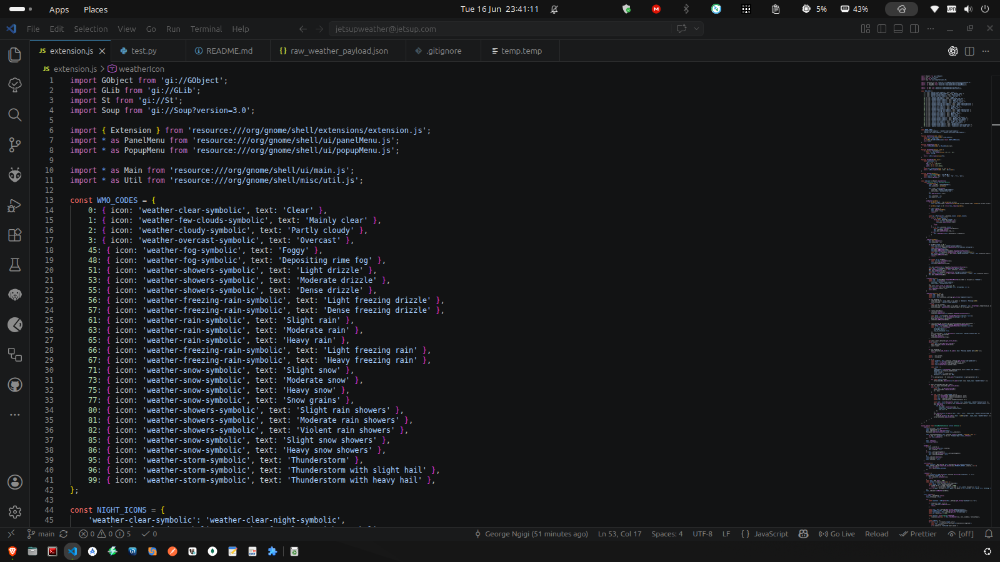
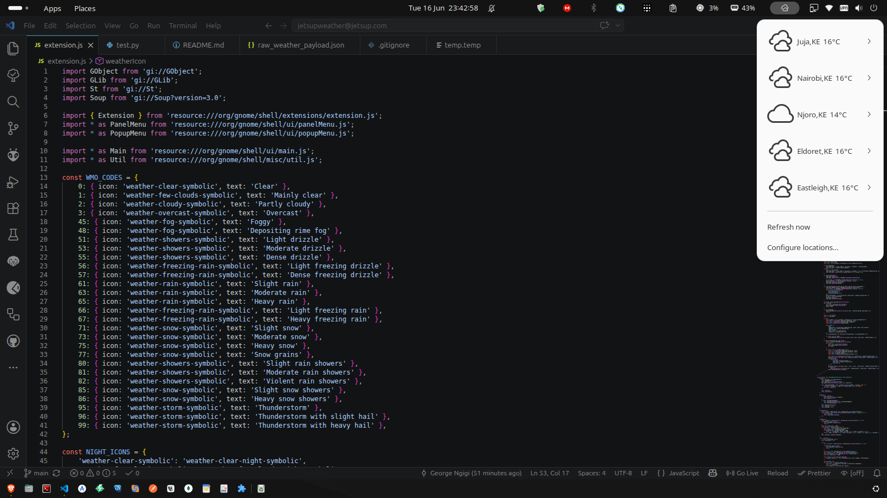
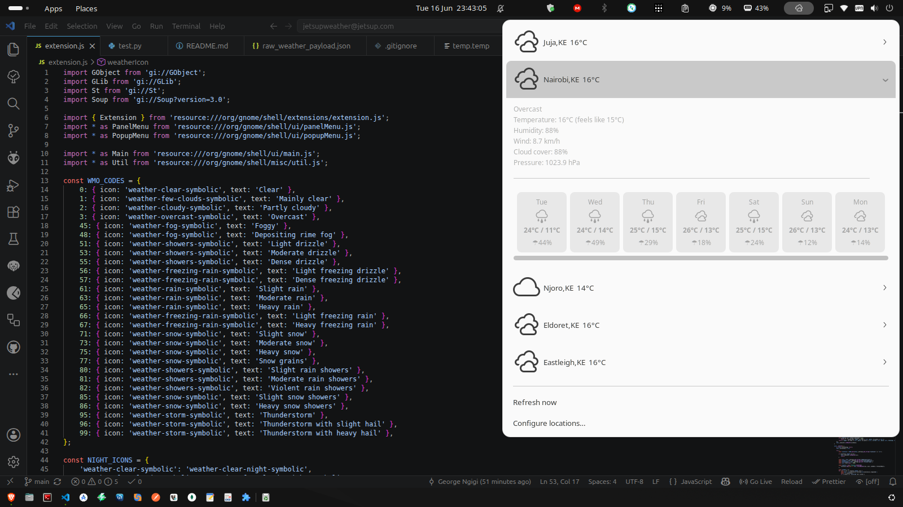
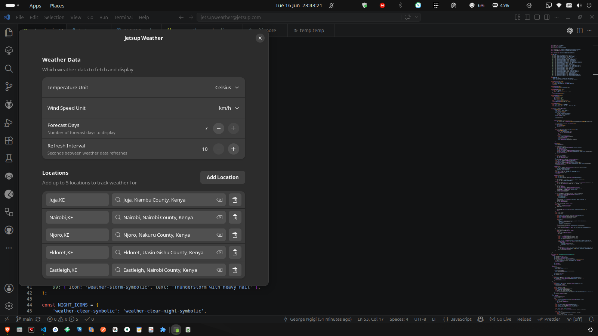

# Jetsup Weather

A GNOME Shell 46 extension that displays weather conditions for multiple locations in the top panel. Click the weather icon to open a menu with current conditions and a horizontal daily forecast for each configured location.

## Features

- **Multi-location support** — Track weather for up to 5 cities
- **Per-location submenus** — Current conditions (temp, humidity, wind, pressure) + daily forecast cards
- **Horizontal forecast scroll** — Scroll through daily weather for each location
- **Configurable units** — Celsius/Fahrenheit, km/h/mph/m/s/knots
- **Auto-refresh** — Configurable interval (10–300s)
- **Adw preferences UI** — Manage locations with live geocoding search
- **No API key required** — Uses the free [Open-Meteo API](https://open-meteo.com/)
- **Night icons** — Automatically switches to night weather icons after sunset

## Requirements

- GNOME Shell 46
- GJS 1.80+
- GLib 2.0
- GTK 4.0 / Adw 1 (for preferences)
- libsoup 3.0

## Installation

1. Clone the repository to the GNOME Shell extensions directory:

    ```bash
    git clone https://github.com/jetsup/jetsupweather.git \
      ~/.local/share/gnome-shell/extensions/jetsupweather@jetsup.com
    ```

2. Compile the GSettings schema:

    ```bash
    cd ~/.local/share/gnome-shell/extensions/jetsupweather@jetsup.com
    glib-compile-schemas schemas/
    ```

3. Restart GNOME Shell (`Alt+F2`, type `r`, Enter) or log out and back in.

4. Enable the extension:

    ```bash
    gnome-extensions enable jetsupweather@jetsup.com
    ```

5. Open the preferences to add locations:

    ```bash
    gnome-extensions prefs jetsupweather@jetsup.com
    ```

## Development Setup

For linting and formatting, you need Node.js 18+ and npm:

```bash
# Install dependencies
npm install

# Run linter
npm run lint

# Format code
npm run format        # writes changes in-place
npm run format:check  # just checks (CI-friendly)
```

### Reloading changes

- **JS-only changes** (extension.js, prefs.js): Disable and re-enable:

    ```bash
    gnome-extensions disable jetsupweather@jetsup.com && \
      gnome-extensions enable jetsupweather@jetsup.com
    ```

- **Schema changes**: Recompile after editing XML:

    ```bash
    glib-compile-schemas schemas/
    ```

    Then restart GNOME Shell or log out/in.

- **Full shell restart** (Wayland):

    ```bash
    kill -9 $(pgrep -x gnome-shell)
    ```

### Preferences process caveats

- The preferences UI runs as a **separate standalone process** (`gnome-extensions prefs`), not inside gnome-shell.
- If `gnome-extensions prefs` hangs, kill stale D-Bus processes:

    ```bash
    pgrep -f 'org.gnome.Shell.Extensions' | xargs -r kill -9
    ```

### Debug logging

Settings changes and API calls are logged to:

```bash
tail -f ~/.local/share/gnome-shell/extensions/jetsupweather@jetsup.com/prefs-debug.log
```

## Project Structure

```txt
jetsupweather@jetsup.com/
├── extension.js        # Main extension: Indicator, weather fetching, menu
├── prefs.js            # Preferences window: location management, settings
├── stylesheet.css      # Forecast card and detail styling
├── schemas/
│   └── org.gnome.shell.extensions.jetsupweather.gschema.xml
├── metadata.json       # Extension metadata
├── test.py             # Python script for API endpoint testing
├── raw_weather_payload.json  # Sample API response for reference
├── package.json        # Dev dependencies (eslint, prettier)
├── eslint.config.js    # ESLint flat config for GJS
├── .prettierrc.json    # Prettier formatting config
└── README.md
```

## Contributing

1. Fork the repository
2. Create a feature branch
3. Make your changes
4. Run `npm run format:check && npm run lint` to verify style
5. Submit a pull request

This project uses [Prettier](https://prettier.io/) for code formatting and [ESLint](https://eslint.org/) for linting. Run `npm run format` before committing to ensure consistent style across all contributions.

### Screenshots

<div style="display: grid; grid-template-columns: repeat(2, minmax(0, 1fr)); gap: 1rem;">
  <figure style="margin: 0;">
    
    <figcaption>Panel view</figcaption>
  </figure>
  <figure style="margin: 0;">
    
    <figcaption>Minimal panel view</figcaption>
  </figure>
  <figure style="margin: 0;">
    
    <figcaption>Detailed weather view</figcaption>
  </figure>
  <figure style="margin: 0;">
    
    <figcaption>Preferences window</figcaption>
  </figure>
</div>

## License

MIT
